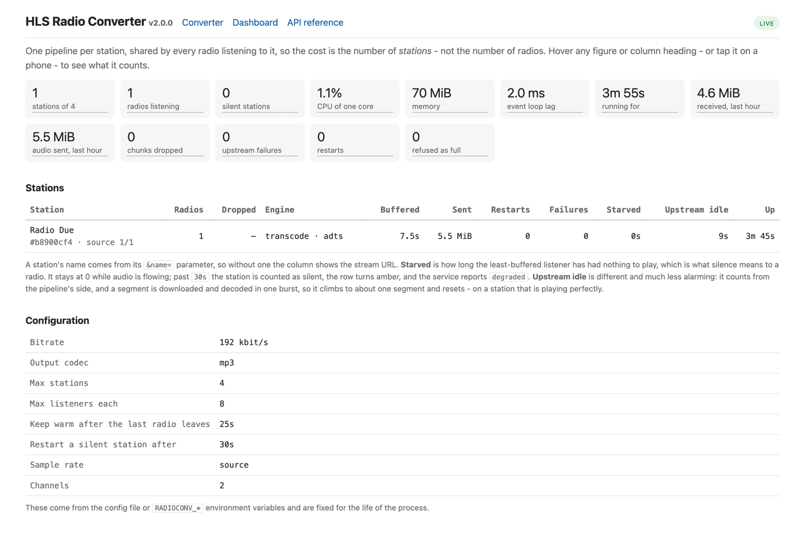
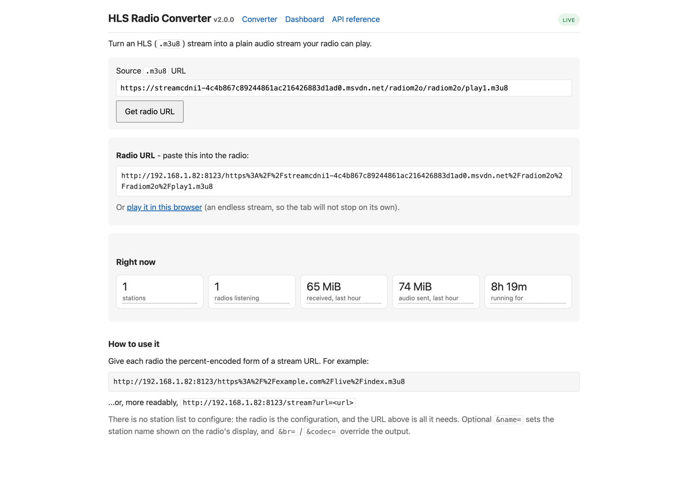

# HLS Radio Converter

Turn an **HLS** (`.m3u8`) Internet radio stream into a plain, continuous HTTP
audio stream that an Internet radio can actually play - for example those based
on Frontier Silicon that understand `audio/mpeg` but not HLS.

```
radio ──► http://pi:8123/https%3A%2F%2F… ──► radioconv ──► HLS origin
                (plain MP3)              (one pipeline per stream URL,
                                          many radios per stream)
```

There is **nothing to configure**. You give each radio the encoded URL of the
station you want it to play, and that is the whole setup - no playlist file, no
station list, nothing to edit on the Pi.

**Requirements:** Python 3.9+ and FFmpeg. On a Raspberry Pi the installer handles
both; see [Quick start](#quick-start).

<a href="docs/dashboard.png"></a>

*The live dashboard at `/dashboard`, showing a Raspberry Pi 3 streaming one
station to one radio. Every figure and column heading explains itself on hover -
or on a tap, if you are reading it on a phone.*

---

## What you get

* **Your radios keep working.** The URL format is byte-for-byte the same as
  version 1, so anything already configured needs no changes.
* **One stream per station, shared by every listener.** Ten radios on one
  station costs one decode, not ten.
* **192 kbit/s MP3 by default**, matching version 1.
* **Encrypted HLS works** (`EXT-X-KEY:AES-128`), including mid-stream key
  rotation.
* **It stays up.** Every socket has a timeout, every buffer is bounded, every
  FFmpeg child is killed on the way out, and a stuck stream is restarted rather
  than left wedged.
* **A page for people.** Open `http://<pi>:8123/` to turn any `.m3u8` URL into
  the string to paste into a radio, and `http://<pi>:8123/dashboard` to watch
  what is going on.

---

## Quick start

### On a Raspberry Pi

```bash
git clone https://github.com/clifarr/HLS-Radio-Converter
cd HLS-Radio-Converter
sudo ./packaging/install.sh
```

It creates the service, starts it, and prints the address your Pi is reachable
on plus the command to generate a radio URL. Check it with:

```bash
systemctl status radioconv        # is it running?
journalctl -u radioconv -f        # watch it work
```

**If `apt` fails with bare `404 Not Found` lines**, your Debian release is
end-of-life (Debian 11 is, and Raspberry Pi OS and OSMC still ship it). Fix it
with:

```bash
sudo ./packaging/install.sh --fix-eol-apt    # keeps a backup of sources.list
```

The installer adds what it needs itself when it can. To do it up front, or if it
tells you something is missing:

```bash
sudo apt install -y python3-venv ffmpeg build-essential python3-dev libffi-dev
```

| Package | Why |
|---|---|
| `ffmpeg` | **Required.** Nearly every station is AAC, which has to be re-encoded to MP3, and only FFmpeg does that. |
| `python3-venv` | Needed to create the virtualenv. |
| `build-essential`, `python3-dev`, `libffi-dev` | Two dependencies have no 32-bit ARM build, so they compile from source. |

### Without the installer

```bash
git clone https://github.com/clifarr/HLS-Radio-Converter
cd HLS-Radio-Converter

uv sync              # or: python3 -m venv .venv && .venv/bin/pip install .
uv run radioconv     # starts the server on port 8123
```

There is also a PyInstaller spec for a machine with no Python at all
(`pyinstaller packaging/radioconv.spec`). See
[CONTRIBUTING.md](CONTRIBUTING.md) for that and for the reasoning behind running
it directly rather than in a container.

---

## Pointing your radio at it

Two equivalent URL shapes. The first is **exactly** what version 1 used, so
radios already configured keep working untouched.

```text
# 1. Version 1 shape: the whole .m3u8 URL, percent-encoded (unchanged)
http://192.168.1.50:8123/https%3A%2F%2Fexample.com%2Flive%2Findex.m3u8

# 2. Readable: a normal query string
http://192.168.1.50:8123/stream?url=https://example.com/live/index.m3u8
```

That is the entire configuration story. You do not register the station
anywhere first: paste the URL into the radio and it works.

Get the exact string to paste with:

```bash
radioconv url 'https://example.com/live/index.m3u8' --host 192.168.1.50
```

Or open `http://192.168.1.50:8123/` in a browser and paste the `.m3u8` URL into
the form. It gives you back the string to copy into the radio:

<a href="docs/landing-page.png"></a>

There is also a live **`http://192.168.1.50:8123/dashboard`** showing what every
station is doing right now - listeners, CPU, memory, restarts, dropped chunks,
and how much audio was sent and received over the last hour - refreshed once a
second. Every figure and column heading explains itself on hover. The page is a
view of the JSON at `/metrics.json`, which is documented in the API reference at
`/docs`; a script or a home-automation rule should read that endpoint directly
rather than parse the page.

### Optional extras

Append these to either URL shape:

| Parameter | Effect |
|---|---|
| `?name=BBC+Radio+6` | The station name shown on the radio's display. Without it the display shows the source URL. |
| `?br=128000` (or `128k`) | Output bitrate. Default is 192 kbit/s. |
| `?codec=aac` | Remux AAC instead of re-encoding to MP3 - much cheaper, if your radio plays AAC. |

Any other query parameter is passed through to the station, because broadcasters
often use query strings for authentication.

### Settings

Config is optional - every setting has a working default. It lives in
`/etc/radioconv/config.toml` for the service, or `~/.config/radioconv/` when you
run it yourself. See `packaging/config.toml.example` for the annotated list.

---

## Hardware: will my Pi cope?

Transcoding is the expensive part, and what costs CPU is the number of
**different stations**, not the number of radios.

Measured on a Raspberry Pi 3 (4 cores, 921 MB):

| State | CPU |
|---|---|
| Idle | ~0.5% of one core |
| **One 192 kbit/s station** | **~165% of one core** (~100 MB RAM) |
| Six radios on that *same* station | unchanged |

So a Pi 3 handles **about two different 192 kbit/s stations**. A Pi 4 or 5 has
far more headroom.

If you need more, in order of preference:

1. Set `output_codec = "adts"` if your radio plays AAC. That avoids re-encoding
   entirely - full quality *and* a fraction of the CPU.
2. Lower `bitrate`, accepting worse audio.
3. Lower `max_sessions` so the Pi refuses extra stations instead of thrashing.

---

## Helpful commands

```bash
radioconv serve                     # run the server (also the default)
radioconv url <m3u8-url>            # the URL to type into the radio
radioconv probe <m3u8-url>          # what is in a stream, and will ffmpeg be needed?
radioconv check --end-to-end        # end-to-end self-test
radioconv --help                    # everything else
```

`radioconv probe` is the fastest way to answer *"why is this station slow?"* -
it fetches the playlist, reports what it found, and stops. Real output for a
master playlist:

```text
URL          : https://example.com/live/index.m3u8
media        : https://example.com/live/audio128/index.m3u8
master       : True (4 variants)
chosen       : 128000 bit/s
segments     : 11 x ~2.0s
container    : ts (segment: ts)
encrypted    : False
audio codec  : aac LC 44100 Hz
passthrough  : True (adts)
TS streams   : 0x0f pid 0x100 -> adts
```

Three lines are worth understanding:

* `chosen` is the **upstream** rendition picked out of the master playlist. The
  audio sent to a radio is the configured `bitrate` (192 kbit/s by default), so
  the two numbers are unrelated. For a playlist that is not a master, `chosen`
  is `None`.
* `passthrough: True (adts)` means **no FFmpeg is needed** for this station -
  the audio is already something a radio can play. That is cheaper *and* better
  quality, so check it before concluding you need a bigger Pi. How the three
  possible engines work is covered in
  [CONTRIBUTING.md](CONTRIBUTING.md#where-ffmpeg-comes-from-per-platform).
* `TS streams` lists what was found inside the MPEG-TS container; `-> adts` means
  it can be extracted directly.

---

## Troubleshooting

| Symptom | Try |
|---|---|
| Radio plays nothing, browser works | Frontier Silicon radios need MP3: keep `output_codec = "mp3"`. |
| Every station silent, service healthy | `radioconv check`. If it reports no FFmpeg, nothing can be transcoded - see the note above on `apt install ffmpeg`. |
| `503 busy` | Raise `max_sessions`, or reduce the number of different stations. |
| Choppy audio | Check the **Starved** column on `/dashboard` first. It is zero while a radio has audio and climbs only when one really has run dry; **Upstream idle** climbing to a segment or so is normal and not the same thing. A new listener is given recent audio immediately, so the jitter buffer is already several seconds deep - if **Starved** moves, the upstream is late or the Pi is saturated, and lowering `bitrate` is the first thing to try. |
| `apt install` fails with `404 Not Found` | End-of-life Debian: `sudo ./packaging/install.sh --fix-eol-apt`. |
| Build fails compiling `cffi` or `psutil` | `sudo apt install build-essential python3-dev libffi-dev`. |
| Stream needs a Referer (403) | `--referer https://www.example.com/` or `referer` in the config file. |
| TLS certificate errors | `insecure = true` (only for a genuinely broken CDN). |
| Service restarting in a loop | `journalctl -u radioconv -n 50`; check `MemoryMax` and `memory_limit_mb`. |
| Want to know if FFmpeg is used | The **Engine** column on `/dashboard`, or `radioconv probe <url>`. |

---

## Coming from version 1

1. Your radios need no changes - `http://ip:8123/<percent-encoded-url>` behaves
   exactly as before.
2. Settings were renamed: `ffmpeg_location` → `ffmpeg_path`, `ip_address` →
   `host`, `buffer_size` → `chunk_size`. `bitrate` and `port` are unchanged, and
   the defaults match, so audio quality is the same out of the box.
3. If your stations are MP3-in-TS you can now drop FFmpeg altogether.

---

## For developers

Building, testing, linting, the module layout, release steps and the reasoning
behind various design decisions are all in
**[CONTRIBUTING.md](CONTRIBUTING.md)**. There is also a full API reference at
`http://<pi>:8123/docs` on any running instance.

---

## License

MIT. See [LICENSE](LICENSE).
