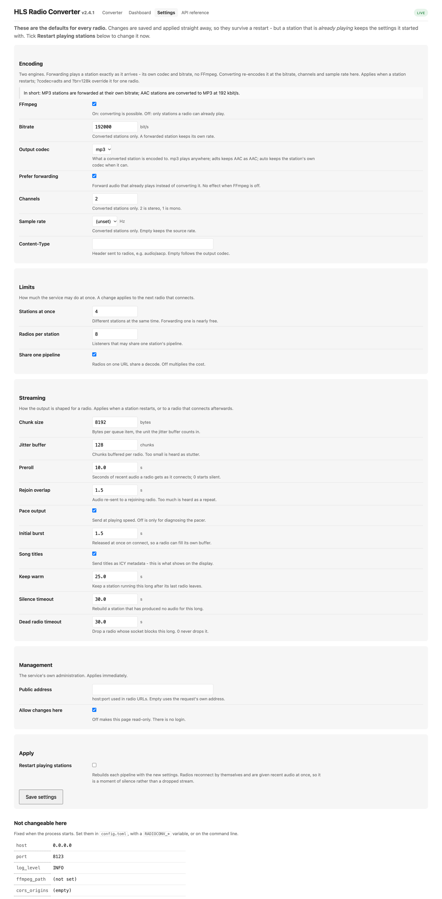

# HLS Radio Converter

Turn an **HLS** (`.m3u8`) Internet radio stream into a plain, continuous HTTP
audio stream that an Internet radio can actually play: **MP3 by default**, or the
station's own audio **forwarded untouched** when the radio can take it and you ask
for that. Frontier Silicon sets, which understand `audio/mpeg` but not HLS, are
the usual reason to need this at all.

```
radio ──► http://host:8123/https%3A%2F%2F… ──► radioconv ──► HLS origin
             (MP3, or the station's own AAC, forwarded)
```

**Nothing has to be configured.** Give each radio the encoded URL of the station
it should play - that is the whole setup: no playlist file, no station list.
[Settings](#settings) only tunes the defaults.

**Requirements:** Python 3.9+ and FFmpeg, and installing this project brings both
- see [Quick start](#quick-start) for what that means on each platform. FFmpeg is
only needed to *re-encode*: a radio that plays AAC can be served without it at
all, see [Running without FFmpeg](#running-without-ffmpeg).

<a href="docs/dashboard.png"></a>

*The live dashboard at `/dashboard`, showing a Raspberry Pi 3 streaming one
station to one radio. Every figure explains itself on hover, or on a tap.*

---

## Who this is for

A small, single-purpose appliance for one problem: **an internet radio whose
stations stopped playing.** You probably own a physical Wi-Fi radio - a Roberts,
Ruark, Revo, Pure, Ocean Digital, Majority, TechniSat or similar set, usually one
that also does DAB+ and FM - whose internet presets have gone dead or silent,
because the broadcaster moved to HLS or the vendor's directory was switched off.
You have an always-on machine on the same network - a Raspberry Pi is the
cheapest way to get one and is what every figure here was measured on, but any
Linux box, Mac or Windows PC that stays awake will do - and the set lets you
**enter a URL by hand**.

**It cannot restore a dead directory.** Nothing here brings a vendor portal back;
it hands the radio one working address at a time - so a set with no way to add a
custom URL is out of scope, however good the converter is at the other end. It is
also not a media server, a station directory, or something to expose to the
internet: there is no authentication and no account to create. For a music
library, AirPlay, Spotify or a phone app, this is the wrong project.

---

## What you get

* **Your radios keep working.** The URL format is byte-for-byte the same as
  version 1, so anything already configured needs no changes.
* **Cheap when your radio plays AAC.** Choose `output_codec = "adts"` (or `auto`)
  and a station whose audio is already playable is forwarded untouched - ~1% of
  one core per station instead of ~165%, no child process, and no second round of
  lossy encoding. MP3 stays the default, so this is a choice, not a surprise; see
  [Many radios need no transcoding](#many-radios-need-no-transcoding).
* **192 kbit/s MP3 by default**, matching version 1, and **one stream per
  station** shared by every listener: ten radios cost one decode, not ten.
* **Encrypted HLS works** (`EXT-X-KEY:AES-128`), including key rotation.
* **It stays up.** Every socket has a timeout, every buffer is bounded, every
  FFmpeg child is killed on the way out, and a stuck stream is restarted.
* **A page for people.** `http://<host>:8123/` turns any `.m3u8` URL into the
  string to paste into a radio, `/dashboard` shows what is going on, and
  `/settings` changes the configuration without editing a file and restarting.

---

## Quick start

**On a Raspberry Pi, or any Linux machine with systemd** - the usual deployment:

```bash
git clone https://github.com/clifarr/HLS-Radio-Converter
cd HLS-Radio-Converter
sudo ./packaging/install.sh
```

It creates the service, starts it, and prints the address this machine is
reachable on plus the command to generate a radio URL. Check it with
`systemctl status radioconv`, and watch it with `journalctl -u radioconv -f`.

**If `apt` fails with bare `404 Not Found` lines**, your Debian release is
end-of-life (Debian 11 is, and Raspberry Pi OS and OSMC still ship it) - fix it
with `sudo ./packaging/install.sh --fix-eol-apt`, which keeps a backup. To put the
prerequisites in place yourself - the build tools matter only on 32-bit ARM,
where two dependencies compile: `sudo apt install -y python3-venv ffmpeg
build-essential python3-dev libffi-dev`.

**Anywhere else - macOS, Windows, or a Linux machine without systemd:**

```bash
git clone https://github.com/clifarr/HLS-Radio-Converter
cd HLS-Radio-Converter
python3 -m venv .venv
.venv/bin/pip install .
.venv/bin/radioconv serve
```

and open `http://localhost:8123/`. On Windows those last two lines are
`.venv\Scripts\pip.exe install .` and `.venv\Scripts\radioconv.exe serve`, and the
firewall asks once whether to allow the port - private networks only.

| Platform | Install | FFmpeg comes from | Autostart |
|---|---|---|---|
| Raspberry Pi / Linux + systemd | `sudo ./packaging/install.sh` | the system package, added by the installer | systemd unit, installed |
| Other Linux | `install.sh --no-service` (apt-based), or pip | `apt`/`dnf install ffmpeg`, or pip's bundled build | your own unit file |
| macOS | pip, above | **pip's bundled build** - nothing to install | `launchd` |
| Windows | pip, above | **pip's bundled build** - nothing to install | Task Scheduler |

"pip's bundled build" is `imageio-ffmpeg`, an ordinary dependency that carries an
FFmpeg binary for macOS (Intel and Apple silicon), Windows (64- and 32-bit) and
Linux (x86_64 and arm64) - but **not 32-bit ARM**, which is why a Pi needs the
system package. An FFmpeg you installed yourself always wins over the bundled one.

Only the *service* half is Linux-specific: `install.sh` writes a systemd unit, and
macOS and Windows supervise a process their own way. Running it in a terminal is
otherwise the whole story - the server needs nothing from systemd. Linux is what
CI tests; macOS was checked end to end (install, serve, both pages, saving
settings), and Windows is supported in the code but not exercised by CI, so treat
a Windows report as new information.

There is also a PyInstaller spec for a machine with no Python at all - see
[CONTRIBUTING.md](CONTRIBUTING.md) for that, and why it does not use a container.

---

## Pointing your radio at it

Two equivalent URL shapes. The first is **exactly** what version 1 used, so
radios already configured keep working untouched.

```text
# 1. Version 1 shape: the whole .m3u8 URL, percent-encoded (unchanged)
http://192.168.1.50:8123/https%3A%2F%2Fexample.com%2Flive%2Findex.m3u8

# 2. Readable: a normal query string
http://192.168.1.50:8123/stream?url=https://example.com/live/index.m3u8
```

**`192.168.1.50` is a placeholder** for this machine's address (the installer
prints the real one); **`8123` is the default port**, changeable with `port` in
`config.toml` or `--port`.

Or open `http://192.168.1.50:8123/` in a browser and paste the `.m3u8` URL into
the form, which gives you back the string to copy into the radio - or ask the CLI
directly with `radioconv url '<m3u8-url>' --host 192.168.1.50`.

<a href="docs/landing-page.png"></a>

There is also a live **`http://192.168.1.50:8123/dashboard`** showing what every
station is doing right now - listeners, CPU, memory, restarts, dropped chunks and
the audio sent and received over the last hour - refreshed once a second, with
every figure explained on hover. It is a view of the JSON at `/metrics.json`
(documented at `/docs`, which a script should read instead of the page).

### Optional extras

Append these to either URL shape:

| Parameter | Effect |
|---|---|
| `?name=BBC+Radio+6` | The station name shown on the radio's display. Without it the display shows the source URL. |
| `?br=128000` (or `128k`) | Bitrate for a station that gets **converted**. Default is 192 kbit/s. A forwarded one plays at its own rate and ignores this. |
| `?codec=adts` | Forward the station's AAC as ADTS instead of re-encoding to MP3 - much cheaper and no quality loss, if your radio plays AAC. |

`br` and `codec` are *encoder* settings, so a forwarded station ignores them - as
it does the bitrate, channels and sample rate on the [settings page](#settings).
`codec` accepts only `mp3` and `adts`; **`aac` is a synonym for `adts`**, the same
engine emitting the same bytes, and `adts` is the spelling used here because it
describes what is emitted: AAC frames in an ADTS transport, which is what an
`audio/aac` HTTP stream is. Choosing it flips the `Content-Type` from
`audio/mpeg` to `audio/aac`, which is what matters on older hardware - see
[Many radios need no transcoding](#many-radios-need-no-transcoding) for which
sets that catches out, and `mime_override` for firmware that wants `audio/aacp`.

Any other query parameter is passed through to the station, because broadcasters
often use query strings for authentication.

### Settings

Config is optional - every setting has a working default. It lives in
`/etc/radioconv/config.toml` for the service, or `~/.config/radioconv/` when you
run it yourself (`%USERPROFILE%\.config\radioconv` on Windows);
`packaging/config.toml.example` has the annotated list. Most of
it can also be changed from the browser at
**`http://192.168.1.50:8123/settings`** - bitrate, codec, forwarding, the listener
limits, the pacing and timeout knobs. A change is validated first (a rejected
value changes nothing and marks the field), saved so it survives a restart, and
it can end the playing stations so they rebuild - radios reconnect by themselves.
What it saves goes in a writable state directory, not beside `config.toml`:
`/var/lib/radioconv` for the service, `~/.local/state/radioconv` when you run it
yourself, `%LOCALAPPDATA%\radioconv` on Windows.

The precedence is: defaults, `config.toml`, anything saved on that page,
`RADIOCONV_*` variables, then flags. A value pinned by the last two cannot be
overridden from the browser; the page says so (`Saved, but not in effect:
bitrate`) rather than pretending. `host`, `port`, `log_level`, `ffmpeg_path` and
`cors_origins` stay in the file - a page that can change its own bind address is
one you lose. `allow_ui_settings = false` makes the installation read-only: the
values still show, and a `POST` is refused with `403`.

<a href="docs/settings.png"></a>

*`/settings`: every value the service reads at runtime, and when it takes effect.*

---

## Many radios need no transcoding

DAB+ broadcasts are HE-AAC, so **a set that receives DAB+ has an AAC decoder in
it** - the hardware is already there. HLS radio streams are overwhelmingly AAC
too, usually HE-AAC at 64-128 kbit/s. When such a radio's *network player* also
accepts AAC over HTTP, the station's bytes can be passed through untouched:

| | Re-encode (`output_codec = "mp3"`, the default) | Forward (`adts`, or `auto`) |
|---|---|---|
| CPU on a Pi 3, per station | ~165% of one core | **~1%** |
| Memory, per station | ~100 MB | ~33 MB |
| Child processes | one FFmpeg per station | none |
| Quality | decoded to PCM and encoded again - lossy twice, and the second loss is ours | the station's own bytes, untouched |

**It does not happen by default.** `output_codec` ships as `mp3`, so an AAC
station is re-encoded even when it did not have to be - the price of "every
station plays on every radio". Choose `adts` or `auto` to forward instead, for
the whole service on the [settings page](#settings) or for one radio with
`?codec=adts` on its URL.

The decoder in the set is only half of it: what matters is whether its **network
player** accepts `audio/aac` over HTTP, which is separate firmware from the DAB+
path and not something a specification sheet promises. Most do; some older
Frontier Silicon builds want it spelled `audio/aacp` (`mime_override`), and a few
decode AAC from DAB+ but only MP3 over the network. Worth checking first -
`radioconv probe <url>`, or paste the URL into `http://<host>:8123/` and tick
**also check the stream**. The verdict names the engine that will be used, and
when the station *could* be forwarded but `output_codec` prevents it, the page
prints the `?codec=` URL that avoids FFmpeg for that one station alone.

### Running without FFmpeg

FFmpeg is **required unless you turn it off**, because MP3-only radios are still
out there and "any station plays" is the promise that costs least to keep. To
turn it off:

```bash
radioconv serve --no-ffmpeg          # for one run
```

```toml
# /etc/radioconv/config.toml        # permanently
ffmpeg_enabled = false
```

or the **FFmpeg** switch on the [settings page](#settings), which also offers to
restart the stations that are playing so the change arrives at once. What
changes is not the same service with fewer features - it is a service with one
engine:

| | FFmpeg enabled (default) | `--no-ffmpeg` |
|---|---|---|
| Output codec | `output_codec` (`mp3`, `adts`, `auto`) | the station's own, always |
| `?codec=` / `?br=` | choose the output and its bitrate | `?codec=` ignored; `?br=` only changes what the radio is *told* |
| fMP4 station, or AAC-only codec we cannot forward | decoded and re-encoded | **cannot be played** - and says so |
| `Content-Type` | matches `output_codec` | `audio/aac` or `audio/mpeg`, matching the station |

Nothing is started and no binary is looked for, so it also runs where FFmpeg
cannot be installed at all. A station that cannot be played is refused with a
reason rather than served as a successful, silent connection - in the log, on
`/probe`, and on the converter page. `radioconv check` reports FFmpeg as
*disabled* rather than failing.

---

## Hardware: how much CPU does it need?

What costs CPU is the number of **different stations**, not the number of radios.
Measured on a Raspberry Pi 3 (4 cores, 921 MB) - any other machine scales from
there:

| State | CPU |
|---|---|
| Idle | ~0.5% of one core |
| **One 192 kbit/s station** | **~165% of one core** (~100 MB RAM) |
| One station forwarded without FFmpeg | **~1% of one core** (~33 MB RAM) |
| Six radios on that *same* station | unchanged |

So a Pi 3 handles **about two different 192 kbit/s stations**, a desktop or a Pi 4
has room to spare, and anything that can forward needs almost nothing. If you
need more:

1. Set `output_codec = "adts"` if your radio plays AAC: no re-encoding at all,
   full quality *and* a fraction of the CPU. When a station supports it, the
   converter page prints the exact URL, without changing anything for others.
2. Lower `bitrate`, accepting worse audio.
3. Lower `max_sessions` so it refuses extra stations instead of thrashing.

---

## Helpful commands

```bash
radioconv serve                     # run the server (also the default)
radioconv url <m3u8-url>            # the URL to type into the radio
radioconv probe <m3u8-url>          # what is in a stream, and will ffmpeg be needed?
radioconv check --end-to-end        # end-to-end self-test
radioconv --help                    # everything else
```

`radioconv probe` is the fastest way to answer *"why is this station slow?"*: it
fetches the playlist, reports what it found, and stops. The converter page does
the same check, opt-in (`also check the stream`) because it downloads a segment
and forks FFmpeg - so a bare URL renders instantly and touches nothing.

Real output for a master playlist:

```text
URL          : https://example.com/live/index.m3u8
media        : https://example.com/live/audio128/index.m3u8
master       : True (4 variants)
chosen       : 128000 bit/s
segments     : 11 x ~2.0s
container    : ts (segment: ts)
encrypted    : False
audio codec  : aac LC 44100 Hz
passthrough  : True (adts)
ffmpeg       : enabled
TS streams   : 0x0f pid 0x100 -> adts
```

Three lines are worth understanding:

* `chosen` is the **upstream** rendition picked out of the master playlist. The
  audio sent to a radio is the configured `bitrate` (192 kbit/s by default), so
  the two numbers are unrelated. For a playlist that is not a master, `chosen`
  is `None`.
* `passthrough: True (adts)` means the station's audio is already something a
  radio can play, so it can be forwarded **without FFmpeg** - cheaper *and*
  better quality, so check this before concluding you need more hardware. Both
  shapes reach it: AAC/MP3 inside an MPEG-TS (extracted by PID) and a bare
  elementary stream, which is what an `.aac` segment is - raw ADTS behind an ID3
  tag, forwarded frame for frame with only the tag removed. Song titles are
  unaffected: they are read from that tag as ICY metadata, not by the encoder.
* `TS streams` lists what was found inside the MPEG-TS container; `-> adts` means
  it can be extracted directly.

`passthrough` describes the **source**, not necessarily the engine you will get:
forwarding an AAC source can only ever produce AAC, so `output_codec = "mp3"`
still re-encodes it. `radioconv probe` says so explicitly in that case, and
`/probe` reports both answers (`passthrough_possible` and `passthrough_engine`).
How the engines work is covered in
[CONTRIBUTING.md](CONTRIBUTING.md#where-ffmpeg-comes-from-per-platform).

---

## Troubleshooting

| Symptom | Try |
|---|---|
| Radio plays nothing, browser works | Frontier Silicon radios need MP3: keep `output_codec = "mp3"`. |
| Radio plays nothing only after switching to `?codec=adts`, though the station is fine | Its firmware may not accept `audio/aac` over HTTP, even though it decodes AAC from DAB+. Try `mime_override = "audio/aacp"` in the config file; if that does not help, that set really does want MP3. |
| Every station silent, service healthy | `radioconv check`. If it reports no FFmpeg, nothing can be transcoded - see the note above on `apt install ffmpeg`. |
| `503 busy` | Raise `max_sessions`, or reduce the number of different stations. |
| Choppy audio | Check the **Starved** column on `/dashboard` first. It is zero while a radio has audio and climbs only when one really has run dry; **Upstream idle** climbing to a segment or so is normal and not the same thing. A new listener is given recent audio immediately, so the jitter buffer is already several seconds deep - if **Starved** moves, the upstream is late or the machine is saturated, and lowering `bitrate` is the first thing to try. |
| A switched-off radio stays on the dashboard, and its **Dropped** count keeps climbing | Normal for up to `listener_write_timeout` (30 s by default). A radio that loses power sends no goodbye, so the kernel keeps the connection for about fifteen minutes; this service puts its own deadline on the write instead, and the listener disappears at that deadline. The server's `ASGI callable returned without completing response` line is how the connection is closed and is expected here. |
| `apt install` fails with `404 Not Found` | End-of-life Debian: `sudo ./packaging/install.sh --fix-eol-apt`. |
| Build fails compiling `cffi` or `psutil` | `sudo apt install build-essential python3-dev libffi-dev`. |
| Stream needs a Referer (403) | `--referer https://www.example.com/` or `referer` in the config file. |
| TLS certificate errors | `insecure = true` (only for a genuinely broken CDN). |
| Service restarting in a loop | `journalctl -u radioconv -n 50`; check `MemoryMax` and `memory_limit_mb`. |
| Want to know if FFmpeg is used, or *why* a station will not play | The **Engine** column on `/dashboard`, or paste the URL into `/` with *also check the stream* ticked: it reports the container, the real codec and the engine without playing anything. |

---

## Coming from version 1

Your radios need no changes - `http://ip:8123/<percent-encoded-url>` behaves
exactly as before. Some settings were renamed (`ffmpeg_location` →
`ffmpeg_path`, `ip_address` → `host`, `buffer_size` → `chunk_size`); `bitrate`
and `port` are unchanged and the defaults match, so audio quality is the same out
of the box. If your stations are MP3-in-TS you can now drop FFmpeg altogether.

---

## For developers

Building, testing, linting, the module layout, release steps and the design
reasoning are in **[CONTRIBUTING.md](CONTRIBUTING.md)**. Any running instance
serves a full API reference at `http://<host>:8123/docs`.

---

## License

MIT. See [LICENSE](LICENSE).
